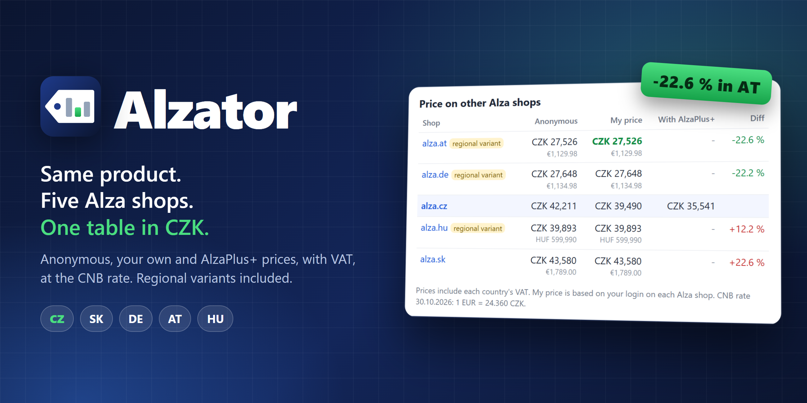
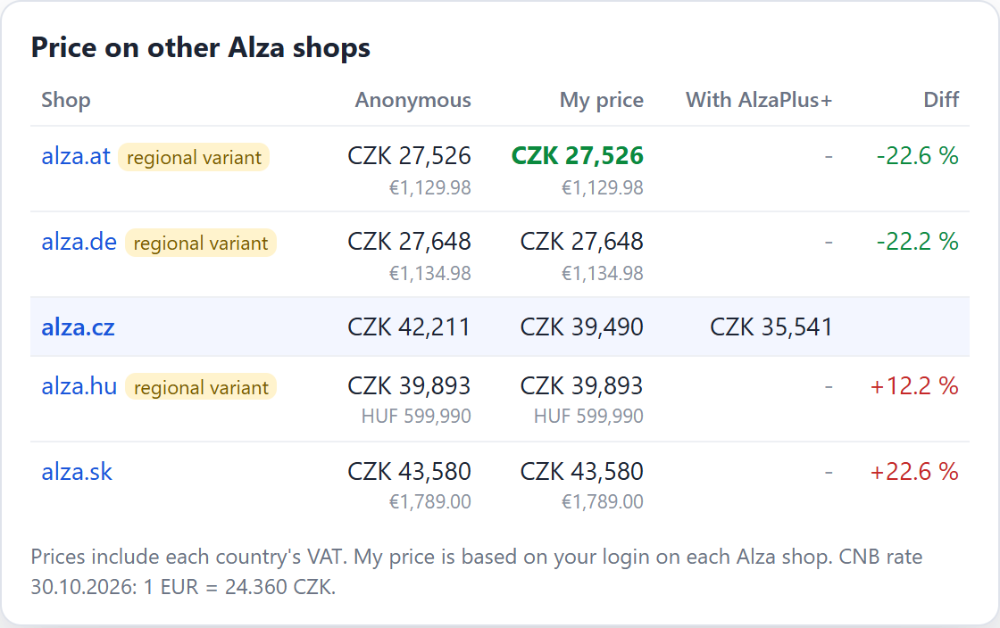

<p align="center">
  
</p>

<p align="center">
  <a href="#install"></a>
  
  
  
  <a href="LICENSE"></a>
</p>

<h1 align="center">
   Alzator
</h1>

<p align="center"><b>Is the same product cheaper on Alza in another country?</b><br>Alzator answers that right on the product page.</p>

Open any product on [alza.cz](https://www.alza.cz), [alza.sk](https://www.alza.sk), [alza.de](https://www.alza.de), [alza.at](https://www.alza.at) or [alza.hu](https://www.alza.hu). Alzator adds a small table under the buy buttons with the price on every Alza shop, converted to CZK at today's Czech National Bank rate.

<p align="center">
  
</p>

<details>
<summary>Czech version (follows your browser language)</summary>
<p align="center">
  
</p>
</details>

<sub>Sample prices of the Samsung Galaxy S26 Ultra 12GB/512GB Black on 2 Nov 2026. The German version is 22 % cheaper than the Czech AlzaPlus+ price.</sub>

## Features

- **All five Alza shops at once**: CZ, SK, DE, AT and HU, sorted from cheapest. The cheapest is highlighted.
- **Prices in CZK** with the original EUR / HUF price underneath, at the official CNB daily rate.
- **Three prices per shop**:
  - *Anonymous*: what a logged-out visitor sees.
  - *My price*: what you pay with your account, without AlzaPlus+.
  - *With AlzaPlus+*: your member price, when Alza shows one.
- **Regional variants are matched.** Alza often sells the German or Hungarian version of a product under a different product ID (for example `...-d13233596.htm` on alza.cz and `...-d13275524.htm` on alza.de for the same phone). Alzator finds it through the Alza product code and marks it as a *regional variant*.
- **Diff against the shop you are on**, using the lowest price you would actually pay.
- **VAT included**: every price is the consumer price with that country's VAT.
- **Works next to Hlídač shopů**: the table sits right above the Hlídač shopů price history.
- **Czech and English UI**, following your browser language.

## Install

Alzator is not in the Chrome Web Store yet, so you install it as an unpacked extension. It takes a minute.

1. **Download the code**
   - Easiest: on this page click **Code** > **Download ZIP**, then extract the ZIP to a folder you will keep (for example `Documents\Alzator`).
   - Or with git: `git clone https://github.com/PsyChonek/Alzator.git`
2. **Open the extensions page**: type `chrome://extensions` into the address bar and press Enter.
3. **Turn on Developer mode** with the switch in the top right corner.
4. **Click "Load unpacked"** and select the folder that contains `manifest.json`.
5. **Open any Alza product**, for example [this graphics card](https://www.alza.cz/gigabyte-geforce-rtx-5070-ti-gaming-oc-16g-d12814009.htm). The table appears under the buy buttons.

Works in Chrome, Edge, Brave, Opera and other Chromium browsers (in Edge the page is `edge://extensions`).

**Updating:** download the new version into the same folder (or `git pull`), then click the reload icon on the Alzator card in `chrome://extensions`.

**Keep the folder.** Chrome loads the extension from that folder, so deleting or moving it removes the extension.

## How it works

1. The product ID comes from the URL (`...-d12814009.htm`). Alza ignores the text before it, so `https://www.alza.de/-d12814009.htm` opens the same product on alza.de.
2. If a shop does not have that ID, Alzator tries the Alza product code with that country's suffix (`/kod/SAMO0285c1DE`) and accepts the result only if the codes match.
3. Prices come from the product data Alza publishes on each page (schema.org JSON-LD). The price without AlzaPlus+ comes from the price box.
4. Each shop is loaded twice: once without cookies (anonymous price) and once with your Alza cookies (your price).
5. Exchange rates come from the [CNB daily rate list](https://www.cnb.cz/cs/financni-trhy/devizovy-trh/kurzy-devizoveho-trhu/kurzy-devizoveho-trhu/denni_kurz.txt).

Product pages are cached for 10 minutes and exchange rates for 6 hours.

## Privacy

- Alzator talks only to the five Alza shops and cnb.cz. There is no server, no analytics and no tracking.
- Your Alza cookies are sent only to Alza, only to load product pages, so you see your own prices. Nothing is added to your cart and nothing is changed in your account.
- The cache lives in your browser's local extension storage.

## Notes

- *My price* on a shop depends on being logged in there. If you are not logged in on alza.de, it shows the anonymous price.
- A regional variant can differ from the Czech version (part number, accessories, language, warranty terms). Check the details before buying abroad.
- Alza can change its pages at any time. If the table shows "failed to load" everywhere, please open an issue.

## Development

No build step, and the extension has no dependencies. Edit the files and reload the extension.

```
src/parse.js        pure parsing helpers (prices, codes, CNB rates)
src/background.js   service worker: fetches shops and rates, caches results
src/content.js      renders the table on product pages
_locales/           Czech and English texts
test/               unit tests (node:test)
```

```
npm run check       # syntax check + unit tests
npm run assets      # re-render README images and icons (needs `npm install` and Chrome)
```

The screenshots are rendered from the real `src/content.js` with sample data, so they always match the current UI.

## License

[MIT](LICENSE)
